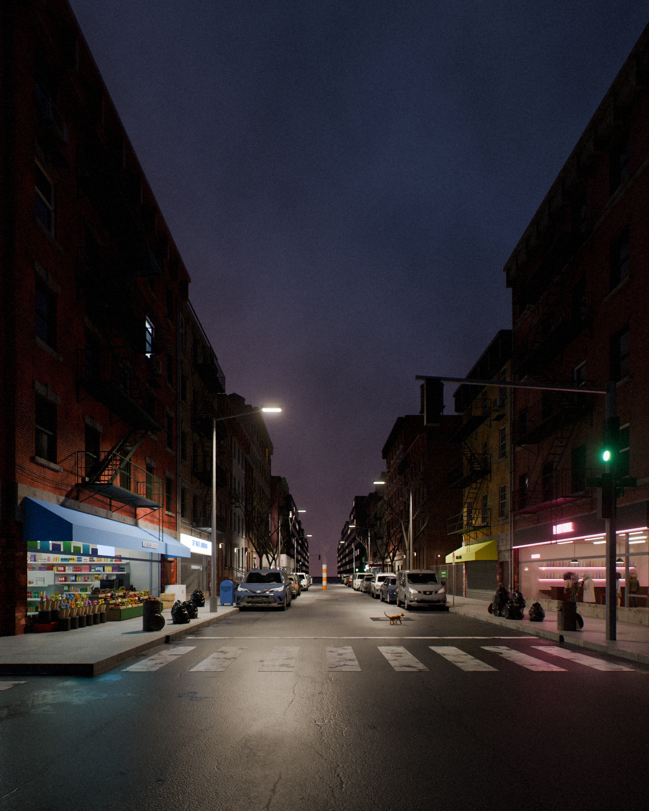
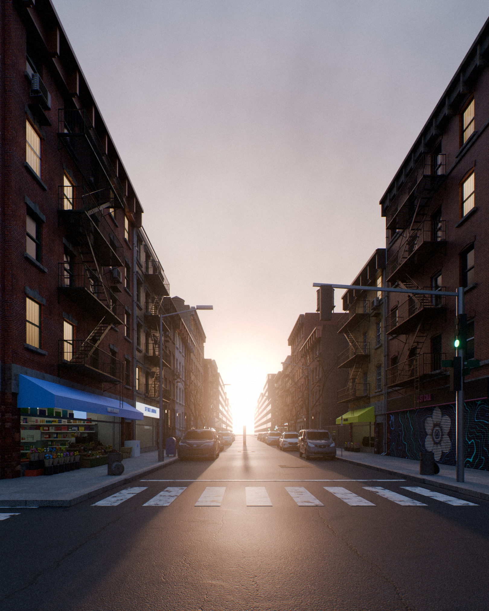

# The Unsupervised Shift

Experiment 53 of MLow's 100 Art Experiments (November 2026).

One brief, eight working hours, no check-ins: "Build one New York block and everything on it, midnight to 8 a.m. Leave a note every time you change your mind."

The block is West 317th Street, which does not exist. Rain from 02:30, the trash truck, a cat that crosses at 03:17, windows coming on one by one, the sun in the slot at 07:13. No real people, brands or logos appear.

**Watch the night:** https://0xmlow.github.io/the-unsupervised-shift/ (the web version, `index.html`)
Options: `?t=03:17` freezes a minute, `?speed=16`, `?clean` hides the text.

| | |
|---|---|
|  |  |

## What is here

| What | Where |
|---|---|
| The notebook, written as it happened and never rewritten | `NOTEBOOK.md` |
| What the block became, what is weak, every file | `EVERYTHING.md` |
| Who lives behind each window | `RESIDENTS.md` |
| Everything that happens, minute by minute | `NIGHT_LOG.md` |
| The night as a web page | `index.html` |
| Three finals (JPEG copies of the 1620x2025 renders) and the hourly contact sheet | `stills/` |
| The GPT-6 Astra critiques and the sheets it saw | `critique/` |
| The night as sound | `sound/night_240s.m4a` |
| Two short films | `media/` |

## How it was made

`block.py` is the source of truth: the block, its people and its night, as data. `build_block.py` and `realism.py` build and render it in Blender 5.1 (Cycles). `build_web.py` writes the web page. `build_sound.py` synthesises the sound. `tools/` holds the bakes, lineups, render queues and checks.

Every layer, named:
- **Code:** written by Claude (Anthropic), working alone through the shift and then through MLow's edit rounds on Nov 18.
- **People:** MLow's own NEW YORKERS cast, his rigged ON LOCATION figures with flower heads and no faces.
- **Taxis:** MLow's MoMLOW cabs (3D models generated with Tripo) and his MLOW CAB CO. checker cab. Ordinary cars are the same bodies repainted.
- **Surfaces and props:** CC0 textures and models from Poly Haven, and textures generated with Adobe Firefly.
- **Critique:** GPT-6 Astra (OpenAI) reviewed contact sheets three times; its notes are in `critique/`.
- **Sound:** synthesised in code, no recordings.

## What is not in this repo

The render assets (MLow's cast and car models, the CC0 and Firefly textures) and the film frames stay on his drive, so the Blender scripts will not run from a fresh clone. The two films in `media/` predate the November 18 edits; the new film will be rendered when the edits are finished.

© MLow 2026. All rights reserved.
